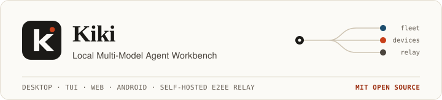
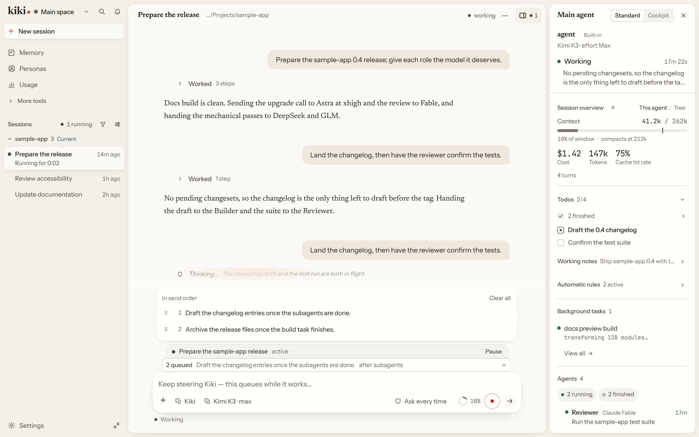
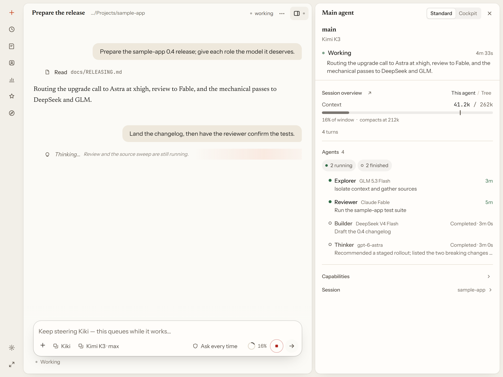
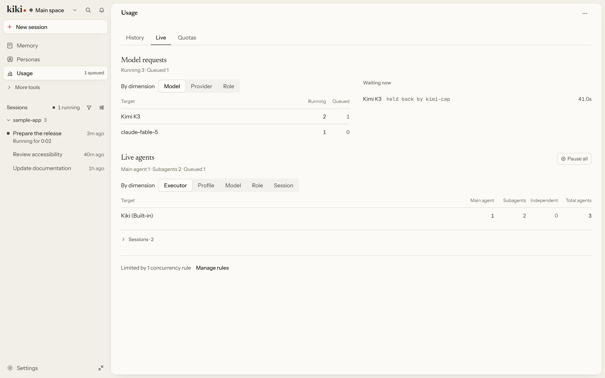
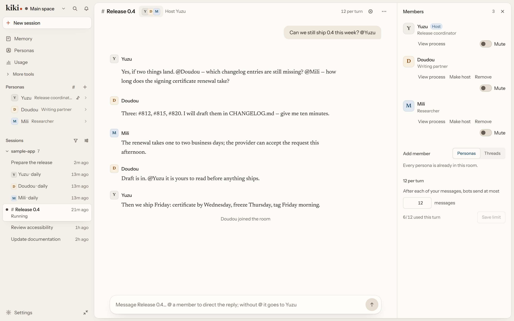

<div align="center">

<picture>
  <source media="(prefers-color-scheme: dark)" srcset="docs/public/assets/banner-dark.svg">
  
</picture>

[](https://github.com/X-T-E-R/kiki/releases) [](LICENSE) [](https://x-t-e-r.github.io/kiki/en/)

[Download](#start-here) · [Docs](https://x-t-e-r.github.io/kiki/en/) · [Plugins](https://github.com/X-T-E-R/kiki-plugins) · [Recipes](https://github.com/X-T-E-R/kiki-recipes) · [Screenshot tour](marketing/gallery.en.md) · [Issues](https://github.com/X-T-E-R/kiki/issues)

English · [简体中文](README.zh-CN.md)

</div>

**One task, several models, across your desktop, terminal, browser, and phone.**

Kiki is an open-source, local agent workbench. The lead session splits the work: a strong model plans, cheaper models handle routine steps, and a different vendor reviews. From the same session, official plugins operate real phones, local desktops, remote VMs, and Office/PDF/3D files. Which model does which part, and how far each may go, is yours to decide. Your agents, your call.

- **Multi-vendor fleet, fitted to each model.** Kimi, Anthropic, OpenAI and Codex, Gemini, and Vertex AI all run in one session, alongside GitHub Copilot and ChatGPT sign-ins. Each native model can bind a [Recipe](https://x-t-e-r.github.io/kiki/en/customization/recipes) — prompts, model settings, and optional script hooks installed once and tuned to that model's habits. Start from [five published recipes](https://github.com/X-T-E-R/kiki-recipes) (GPT-6.1 Sol, GPT-6 Astra, DeepSeek V4.1, Gemini 4 Argon, Gemini 3.8 Flash) or write your own.
- **Operate real devices and remote GUIs.** Official plugins connect the same agent to physical Android/iOS phones ([`kiki-phone`](https://github.com/X-T-E-R/kiki-plugins/tree/main/plugins/official/kiki-phone) over warm `scrcpy`), local multi-DPI desktops ([`kiki-cua`](https://github.com/X-T-E-R/kiki-plugins/tree/main/plugins/official/kiki-cua)), and NetEase UU Remote, Proxmox VE, or VNC desktops ([`kiki-uu-remote`](https://github.com/X-T-E-R/kiki-plugins/tree/main/plugins/official/kiki-uu-remote)) — with 60fps resident preview panels (`0ms` re-open across session switches) and one-click Human Takeover protection.
- **Cross-device sessions on your machines.** Work files stay in the folder you choose; sessions, history, and config stay in your local Kiki home; model requests go only to the providers or local servers you connect. The Electron desktop app, terminal (`kiki`), browser (`kiki web`), Android app (connect to your PC over LAN or self-hosted E2EE `kiki-relay`, or run Kiki locally on Android with bundled Bionic Node), and WeChat/QQ bindings share the same work.
- **Documents, media, and every step in view.** Official plugins cover local PDF/Office extraction (`kiki-extract`), Word/Excel/PowerPoint editing (`kiki-office`), CSV checks (`kiki-work`), and Image/Video/TTS/3D generation (`kiki-media`). Every subagent transcript, token cost, concurrency rule, and prompt override stays inspectable.

<picture>
  <source media="(prefers-color-scheme: dark)" srcset="docs/public/shots/theme-dark/wl-20261005-hero-workbench.en.dark.png">
  
</picture>

## Start here

### Download desktop, Android, or CLI

Pick your platform from [GitHub Releases](https://github.com/X-T-E-R/kiki/releases) (`kiki-v<version>`):

| Platform | Desktop / Mobile App | Standalone CLI / TUI |
| --- | --- | --- |
| Windows x64 | [`Kiki_*_x64-setup.exe`](https://github.com/X-T-E-R/kiki/releases/latest) (adds `kiki` to user `PATH`; bundles self-contained Git Bash and `rg` in 0.7+) | Included in the installer |
| macOS Apple Silicon | [`Kiki_*_aarch64.dmg`](https://github.com/X-T-E-R/kiki/releases/latest) | `kiki-darwin-arm64` |
| macOS Intel | [`Kiki_*_x64.dmg`](https://github.com/X-T-E-R/kiki/releases/latest) | `kiki-darwin-x64` |
| Linux x64 | [`Kiki_*_amd64.deb`](https://github.com/X-T-E-R/kiki/releases/latest) (adds `kiki` to `PATH`) or `.AppImage` | `kiki-linux-x64` |
| Linux ARM64 | — | `kiki-linux-arm64` |
| Android 7.0+ | [`Kiki_*_android-release.apk`](https://github.com/X-T-E-R/kiki/releases/latest) (connect to PC or run standalone on phone; signed in-app updater) | — |

On first desktop launch, connect a model (account sign-in, API key verified before saving, or an existing sign-in on this machine), or run the one-minute offline tour (**Discover Kiki** in the sidebar brings it back any time).

On Linux or macOS, install the standalone CLI without Node.js:

```sh
curl -fsSL https://github.com/X-T-E-R/kiki/releases/latest/download/install.sh | sh
```

Or install with npm (Node.js 24.22.1+ or 26.12.1+):

```sh
npm install -g kiki-agent   # CLI/TUI + matching desktop build (`kiki-agent-lite` for CLI/TUI only)
cd your-project
kiki                        # terminal UI; `kiki web` for browser, `kiki desktop` for desktop app
```

<details>
<summary>Checksums, macOS first-launch, and Windows CLI notes</summary>

- Every installer, APK, and standalone CLI asset ships with an adjacent `.sha256` checksum file (Android releases also include `android-receipt.json`). Verify with `kiki --version` after install.
- **macOS:** the `.dmg` is currently unsigned and not notarized. Verify the checksum, drag Kiki to Applications, and use **Control-click → Open** on first launch; link the bundled CLI manually if you want `kiki` on `PATH`.
- **Windows:** the 0.7+ Electron desktop installer bundles its own relocatable Git Bash, `git`, and `rg` toolchain with zero extra downloads. If you install only the CLI via npm on Windows without the desktop bundle, install [Git for Windows](https://gitforwindows.org/) (or set `KIKI_SHELL_PATH` to `bash.exe`).
- See [Installation](https://x-t-e-r.github.io/kiki/en/getting-started/installation) for checksum commands, update channels, and `install.sh --apply` cloud-notebook space cloning.

</details>

### First task

Run `/login` in the terminal (or open **Settings → AI** in the desktop app) to connect Kimi Code OAuth, a Kimi Platform key, or any other provider listed in [Providers and models](https://x-t-e-r.github.io/kiki/en/configuration/providers). Then ask for something concrete:

```
Take a look at this project and explain its main directories.
```

The same workbench handles non-code folders. Install [Kiki Extract](https://x-t-e-r.github.io/kiki/en/customization/plugins#local-document-extraction) (PDF/Office conversion uses Python with MarkItDown) or [Kiki Office Suite](https://github.com/X-T-E-R/kiki-plugins/tree/main/plugins/official/kiki-office) from the catalog, then ask:

```
Read the PDFs in ./sources, check their figures against budget.xlsx, and write summary.md with the file each number came from.
```

New sessions start in **Auto**: routine work runs on its own, and you are asked before touching sensitive files or running dangerous commands. `/permission` switches among Ask every time (`manual`), Auto (`auto`), Approve for me (`review`), and Full access (`yolo`).

## Do one thing first

Choose the folder Kiki works in and what it should read, then hand it the task. Normal, Plan, and Goal shape how the task is done, and the result keeps its sources and the steps behind it. When you start a session you can also pick a git worktree, so that session's work lands on its own branch instead of your checkout. Temporary conversations stay out of history, search, and memory, and are deleted when they end.

See [First launch](https://x-t-e-r.github.io/kiki/en/getting-started/first-launch) and [Interaction and approvals](https://x-t-e-r.github.io/kiki/en/guides/interaction).

## Understand and direct work

### Give every agent its own model

The lead agent splits your task and dispatches subagents, and each one can run a different model — or a different vendor — in the same session. A strong reasoning model can plan while cheaper models do the routine work, and a review by a different vendor is not anchored to the same blind spots as the implementation. Kimi works out of the box; Anthropic, OpenAI-compatible services, the OpenAI Responses API, Gemini, and Vertex AI can be added, and you can sign in with a GitHub Copilot or ChatGPT account.



Agents themselves are Markdown files you own: the frontmatter sets tools, model, effort, and which agents it may dispatch, and the body is the system prompt. Save the file and the next dispatch uses it, while a session already running keeps the snapshot it started with until you rebuild its context. You can create a profile by copying an existing one, starting from a shipped template, or starting blank.

Open any dispatched subagent to read its own transcript, and message it from its own composer. While the agent works, what you type joins a queue rather than cutting in, and each queued message can go out after this turn, after its subagents finish, or after its background tasks finish. Long commands move to the background and notify the agent when they finish, so it never has to poll. See [One workbench, many lines](https://x-t-e-r.github.io/kiki/en/features/workbench) and [Agents and Sub-Agents](https://x-t-e-r.github.io/kiki/en/customization/agents-and-subagents).

### Work in the window you have open

Finished stretches of tool calls, thinking, and shell output fold into one line such as "Worked · 8 steps", and every fold opens back up in order. The right rail shows pending approvals and questions, what the agent is doing now, context and cost, its working notes, the agent team, and background tasks — and it follows you into a subagent. Annotations let you leave a note on a message and send it with your next one instead of interrupting with a separate turn.

The agent can search its own earlier messages and tool output — including text from before a compaction — with `HistorySearch` and `HistoryRead`, and you can search sessions by title in the sidebar. Streaming CPU-worker journal indexing keeps cold open sub-second even on 3GB+ multi-week sessions without freezing the UI, while cache-safe context compaction preserves the KV-cache prefix across compaction boundaries (`>=99%` cache hit retention on 250k+ long runs) instead of blowing up prompt cost after a summary. Web search and fetch run on named lanes you can inspect; GitHub repository search works without a key. Appearance is six built-in skins, picture and video backgrounds, and appearance packs that bundle colors with media. See [The daily driver](https://x-t-e-r.github.io/kiki/en/features/daily) and [Look and feel](https://x-t-e-r.github.io/kiki/en/features/look).

### Know what it costs, and where the numbers go

The **Usage** page breaks a date range into tokens, cost, and cache hit rate — a provider that never returned usage reads as unknown rather than as a real zero — and names the concurrency rule holding each waiting request. External sync sends only content-free numbers, never a prompt, answer, title, or path, to a webhook, a VibeCafe account, or a script you approve, and nothing is sent until you add a destination, preview the exact payload, agree once, and enable it.



See [The daily driver](https://x-t-e-r.github.io/kiki/en/features/daily) and [`kiki usage-export`](https://x-t-e-r.github.io/kiki/en/reference/command#kiki-usage-export).

## Keep work going

A goal keeps the target in view across turns instead of restating the task each time.

Memory is what outlives the session: preferences, feedback, verified project facts, and references, kept as global, per workspace, or per persona, each with its basis and any check to run before reuse. You can read every entry, and undo ordinary changes one operation at a time — including a delete; only an explicit `forget` clears history permanently. Set new memories to wait in the review inbox and proposed writes wait for your approval instead of applying themselves. Export an entry as Markdown, edit it, and review the diff before it saves, or turn on Memory Advisor so a decision service or model you choose picks the entries each turn should bring along. See the [memory guide](https://x-t-e-r.github.io/kiki/en/guides/memory).

Each workspace can also add a board (via the optional `kiki-task-board` plugin) where requirements are cards that link to the sessions working on them, and the agent reads and updates it. Scheduled prompts cover the recurring case: a prompt fires on a cron schedule while a Kiki process holds that session open. See [Work that runs long](https://x-t-e-r.github.io/kiki/en/features/long-work).

## Extend Kiki when needed

### Personas you can talk to

A **persona** is a long-term identity — a name, an avatar, what it is for, the standing rules for how it works, and its own memory — stored as a Markdown file you can read and edit. Clicking its name lands you in the same conversation every time, so "ask Yuzu" means one thing; the same persona can hold several conversations at once for different projects.

A **room** puts two to six of them on one topic, speaking in order, with a host, a budget, and pause and continue. Alongside rooms, **cross-session peer threads** (`ThreadSend`, `ThreadRead`, `ThreadWait`, and `@Thread` references) let long-lived sessions — engineering, research, or patrol — exchange findings and wake each other directly.

A persona is not an agent profile. A profile is execution configuration — tools, permissions, model, effort; a persona is identity — who it is and what it remembers. Rebinding one does not touch the other. See [Roles you can talk to](https://x-t-e-r.github.io/kiki/en/features/people).



### Skills, plugins, and device control

A plugin can add skills, agents, MCP servers, hooks, commands, panels, and tools; browse and install them from the [plugin catalog](https://github.com/X-T-E-R/kiki-plugins) on the Capabilities page. Each package is independently versioned, checksum-pinned, configured, and enabled on its own:

- **Device and remote GUI control:** `kiki-cua` (local multi-DPI desktop control + cross-plugin remote target bus), `kiki-phone` (physical Android/iOS control via Mobilewright or Mobile MCP with warm `scrcpy` streaming), and `kiki-uu-remote` (NetEase UU Remote, Proxmox VE VMs over lossless RFB 3.8, and VNC desktops) — all with 60fps resident preview panels (`0ms` re-open across session switches) and Human Takeover protection.
- **Documents, media, and operations:** `kiki-extract` (local PDF/Office/HTML to Markdown), `kiki-office` (Word/Excel/PowerPoint editing and preview), `kiki-work` (read-only CSV/TSV checks), `kiki-writing`, `kiki-notion`, `kiki-media` (Image, Video, TTS, and 3D providers plus local scripts), `kiki-voice`, `kiki-task-board`, `kiki-sites`, `kiki-mail`, `kiki-qq`, `kiki-bilibili`, `kiki-everything` (Windows Everything 1.5 search), and `kiki-output-layer`.
- **Browser and network bridges:** browser control connects to Ego Lite, a browser extension (Codex / ChatGPT or Kimi Browser Extension), an independent profile, or CDP; remote reachability is supported through `kiki-relay` (self-hosted E2EE rendezvous relay) or `kiki-cloudflare` (Cloudflare Tunnel).

Sessions stay on your machine with no mandatory cloud relay; when you want cross-device access without a public IP, self-host `kiki-relay` with end-to-end TLS 1.3 pinned to your space's SPKI fingerprint. See [Make it yours to extend](https://x-t-e-r.github.io/kiki/en/features/extend) and [Plugins](https://x-t-e-r.github.io/kiki/en/customization/plugins).

## Your data, your machines

A **space** is a Kiki you open, with its own shortcuts, window behavior, and credential scope — shared with the main space or isolated — so a work Kiki and a personal Kiki can sit side by side without sharing what they sign in to.

**Android (dual-mode):** on first launch, choose **Connect to PC Kiki** (lightweight remote shell over LAN or self-hosted E2EE `kiki-relay`, with no local runtime overhead) or **Run Kiki locally on phone** (embeds Bionic Node directly on Android). Signed release APKs support SHA-256 and certificate-verified in-app updates.

**Encrypted relay (`kiki-relay`):** run a lightweight Node.js or Docker reverse-pool rendezvous server when your desktop sits behind NAT. Inner streams remain end-to-end TLS 1.3 pinned to the target space's P-256 SPKI fingerprint (`fp`), so the relay operator never terminates inner TLS or reads session credentials.

**Remote connections** point one Kiki home at another with an approval on each side, and every connection is one row with its own state. A **thread bridge** is narrower: a one-way channel for messages between two homes that never grants browsing access. **Web access** opens this Kiki in a browser on another device through a single-use link, and turning it off revokes every link without stopping work already running. **SSH hosts** joined to a session belong to that session, so the timeline stays clean. Pair a WeChat or QQ chat to a persona or session to reply and approve steps when you are away from the desk. See [Your data, your machines](https://x-t-e-r.github.io/kiki/en/features/spaces) and [Phone session](https://x-t-e-r.github.io/kiki/en/features/phone).

## Bring in history, plug in other tools

Any built-in prompt field can be replaced, down to a single tool description, globally or per model or agent, and `kiki prompt-fields` shows what the model will receive. Import another tool's conversations as Kiki sessions you can keep working in, or as read-only archives; the preview tells you what is kept and what is not, and nothing is installed or trusted to reach it. `kiki acp` puts Kiki inside Zed, JetBrains, and other ACP clients, and `kiki seat` lets Cursor, Claude Code, or Codex call it as a service with the workspace, permission mode, and model fixed before they connect. An agent profile can also run on another harness entirely as its engine. See [Bring your history, meet other tools](https://x-t-e-r.github.io/kiki/en/features/ecosystem) and [Every layer is yours](https://x-t-e-r.github.io/kiki/en/features/freedom).

## Docs

[All features](https://x-t-e-r.github.io/kiki/en/features/) · [First launch](https://x-t-e-r.github.io/kiki/en/getting-started/first-launch) · [Desktop app](https://x-t-e-r.github.io/kiki/en/getting-started/desktop-app) · [Agent profiles](https://x-t-e-r.github.io/kiki/en/customization/agent-profiles) · [Plugins](https://x-t-e-r.github.io/kiki/en/customization/plugins) · [Interaction and approvals](https://x-t-e-r.github.io/kiki/en/guides/interaction) · [Configuration](https://x-t-e-r.github.io/kiki/en/configuration/config-files) · [Command reference](https://x-t-e-r.github.io/kiki/en/reference/command) · [Tool reference](https://x-t-e-r.github.io/kiki/en/reference/tools)

## Develop from source

Requirements: Node.js 24.22.1+ or 26.12.1+, pnpm 10.33.0.

```sh
git clone https://github.com/X-T-E-R/kiki.git && cd kiki && pnpm install
pnpm dev:cli    # run the CLI in dev mode
pnpm test       # tests  ·  pnpm typecheck  ·  pnpm lint  ·  pnpm build
```

See [CONTRIBUTING.md](CONTRIBUTING.md) for the full guide. Report bugs in [Issues](https://github.com/X-T-E-R/kiki/issues); for security vulnerabilities, see [SECURITY.md](SECURITY.md).

## Acknowledgements

Kiki began as a fork of [Kimi Code](https://github.com/MoonshotAI/kimi-code) and is now developed independently. Its TUI is built on [`pi-tui`](https://github.com/earendil-works/pi-mono/tree/main/packages/tui). The desktop app adapts code and interaction patterns from several other open-source projects. [ACKNOWLEDGEMENTS.md](ACKNOWLEDGEMENTS.md) lists each project, what Kiki took from it, and its license.

## License

Released under the [MIT License](LICENSE).

## Friends

[Linux.do](https://linux.do/)
