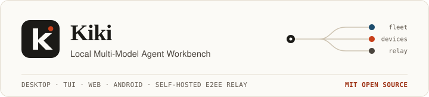
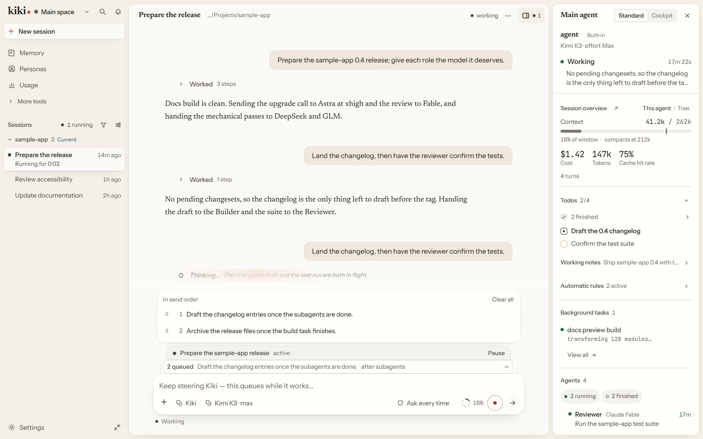
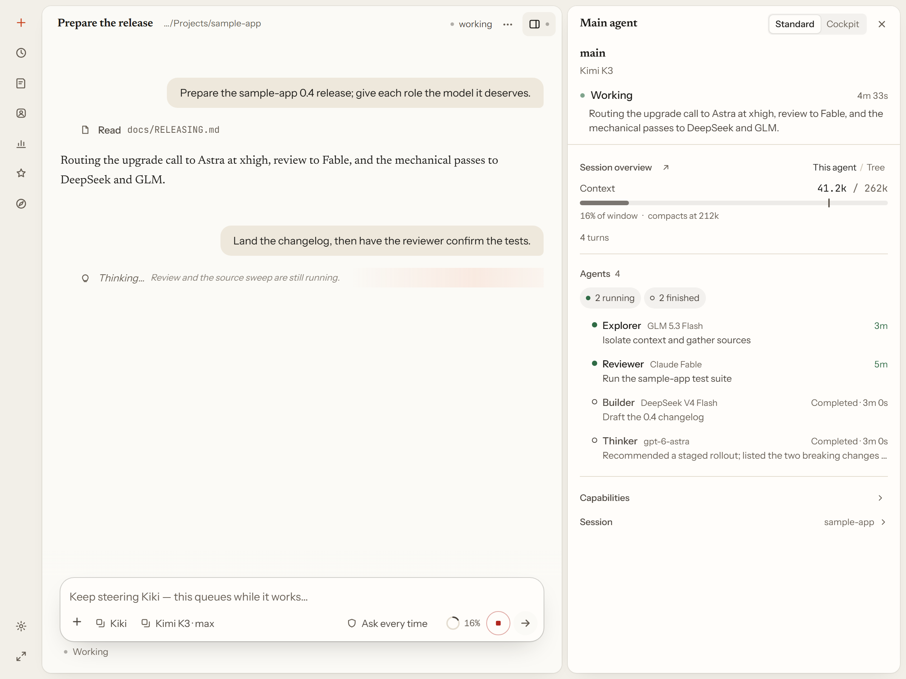
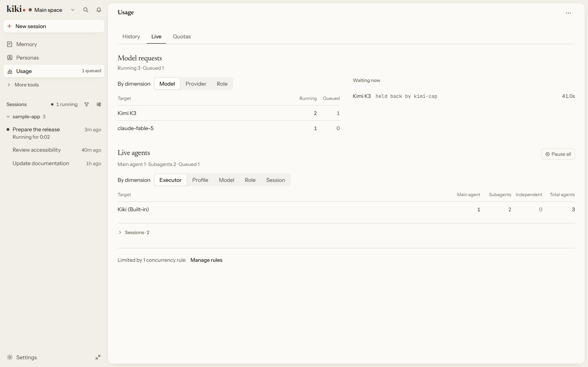
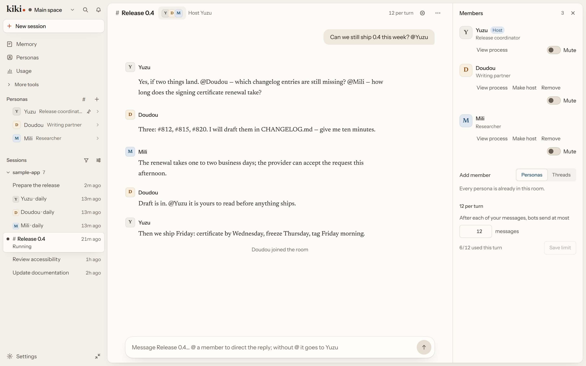

<div align="center">

<picture>
  <source media="(prefers-color-scheme: dark)" srcset="docs/public/assets/banner-dark.svg">
  
</picture>

[](https://github.com/X-T-E-R/kiki/releases) [](LICENSE) [](https://x-t-e-r.github.io/kiki/en/)

[İndir](#buradan-başlayın) · [Belgeler](https://x-t-e-r.github.io/kiki/en/) · [Eklentiler](https://github.com/X-T-E-R/kiki-plugins) · [Tarifler](https://github.com/X-T-E-R/kiki-recipes) · [Ekran görüntüsü turu](marketing/gallery.en.md) · [Sorunlar](https://github.com/X-T-E-R/kiki/issues)

[English](README.md) · [简体中文](README.zh-CN.md) · Türkçe

</div>

**Tek bir görev, birden fazla model — masaüstünüzde, terminalinizde, tarayıcınızda ve telefonunuzda.**

Kiki, açık kaynaklı ve yerel bir ajan çalışma tezgâhıdır. Ana oturum işi böler: güçlü bir model plan yapar, daha ekonomik modeller rutin adımları yürütür ve farklı bir sağlayıcı inceleme yapar. Aynı oturumdan resmî eklentiler gerçek telefonları, yerel masaüstlerini, uzak sanal makineleri ve Office/PDF/3B dosyalarını yönetir. Hangi modelin hangi parçayı üstleneceğine ve ne kadar ileri gidebileceğine siz karar verirsiniz. Sizin ajanlarınız, sizin kararınız.

- **Her modele uyarlanmış çok sağlayıcılı filo.** Kimi, Anthropic, OpenAI ve Codex, Gemini ile Vertex AI aynı oturumda birlikte çalışır; GitHub Copilot ve ChatGPT oturumları da desteklenir. Her yerel model bir [Tarif (Recipe)](https://x-t-e-r.github.io/kiki/en/customization/recipes) bağlayabilir — o modelin alışkanlıklarına göre ayarlanmış istemler, model ayarları ve isteğe bağlı betik kancaları tek seferde kurulur. [Yayımlanmış beş tarifle](https://github.com/X-T-E-R/kiki-recipes) (GPT-6.1 Sol, GPT-6 Astra, DeepSeek V4.1, Gemini 4 Argon, Gemini 3.8 Flash) başlayabilir veya kendi tarifinizi yazabilirsiniz.
- **Gerçek cihazları ve uzak grafik arayüzlerini yönetin.** Resmî eklentiler aynı ajanı fiziksel Android/iOS telefonlara (sıcak `scrcpy` üzerinden [`kiki-phone`](https://github.com/X-T-E-R/kiki-plugins/tree/main/plugins/official/kiki-phone)), yerel çoklu-DPI masaüstlerine ([`kiki-cua`](https://github.com/X-T-E-R/kiki-plugins/tree/main/plugins/official/kiki-cua)) ve NetEase UU Remote, Proxmox VE veya VNC masaüstlerine ([`kiki-uu-remote`](https://github.com/X-T-E-R/kiki-plugins/tree/main/plugins/official/kiki-uu-remote)) bağlar — 60 fps kalıcı önizleme panelleri (oturum geçişlerinde `0ms` yeniden açılış) ve tek tıkla İnsan Devralma (Human Takeover) korumasıyla birlikte.
- **Kendi makinelerinizde cihazlar arası oturumlar.** Çalışma dosyaları seçtiğiniz klasörde kalır; oturumlar, geçmiş ve yapılandırma yerel Kiki dizininizde durur; model istekleri yalnızca bağladığınız sağlayıcılara veya yerel sunuculara gider. Electron masaüstü uygulaması, terminal (`kiki`), tarayıcı (`kiki web`), Android uygulaması (PC'nize LAN veya kendi barındırdığınız uçtan uca şifreli `kiki-relay` üzerinden bağlanın ya da dahili Bionic Node ile Kiki'yi doğrudan Android'de çalıştırın) ve WeChat/QQ bağlantıları aynı çalışmayı paylaşır.
- **Belgeler, medya ve her adım göz önünde.** Resmî eklentiler yerel PDF/Office çıkarımı (`kiki-extract`), Word/Excel/PowerPoint düzenleme (`kiki-office`), CSV kontrolleri (`kiki-work`) ve Görsel/Video/TTS/3B üretimini (`kiki-media`) kapsar. Her alt ajan dökümü, token maliyeti, eşzamanlılık kuralı ve istem geçersiz kılması incelenebilir kalır.

<picture>
  <source media="(prefers-color-scheme: dark)" srcset="docs/public/shots/theme-dark/wl-20261005-hero-workbench.en.dark.png">
  
</picture>

## Buradan başlayın

### Masaüstü, Android veya CLI indirin

Platformunuzu [GitHub Releases](https://github.com/X-T-E-R/kiki/releases) (`kiki-v<version>`) sayfasından seçin:

| Platform | Masaüstü / Mobil Uygulama | Bağımsız CLI / TUI |
| --- | --- | --- |
| Windows x64 | [`Kiki_*_x64-setup.exe`](https://github.com/X-T-E-R/kiki/releases/latest) (`kiki` komutunu kullanıcı `PATH`'ine ekler; 0.7+ sürümlerinde kendi kendine yeten Git Bash ve `rg` dahildir) | Yükleyiciye dahildir |
| macOS Apple Silicon | [`Kiki_*_aarch64.dmg`](https://github.com/X-T-E-R/kiki/releases/latest) | `kiki-darwin-arm64` |
| macOS Intel | [`Kiki_*_x64.dmg`](https://github.com/X-T-E-R/kiki/releases/latest) | `kiki-darwin-x64` |
| Linux x64 | [`Kiki_*_amd64.deb`](https://github.com/X-T-E-R/kiki/releases/latest) (`kiki` komutunu `PATH`'e ekler) veya `.AppImage` | `kiki-linux-x64` |
| Linux ARM64 | — | `kiki-linux-arm64` |
| Android 7.0+ | [`Kiki_*_android-release.apk`](https://github.com/X-T-E-R/kiki/releases/latest) (PC'ye bağlanın veya telefonda bağımsız çalıştırın; imzalı uygulama içi güncelleyici) | — |

İlk masaüstü açılışında bir model bağlayın (hesap girişi, kaydetmeden önce doğrulanan API anahtarı veya bu makinedeki mevcut bir oturum) ya da bir dakikalık çevrimdışı turu çalıştırın (kenar çubuğundaki **Discover Kiki** bunu istediğiniz zaman geri getirir).

Linux veya macOS'ta Node.js olmadan bağımsız CLI'ı kurun:

```sh
curl -fsSL https://github.com/X-T-E-R/kiki/releases/latest/download/install.sh | sh
```

Veya npm ile kurun (Node.js 24.22.1+ veya 26.12.1+):

```sh
npm install -g kiki-agent   # CLI/TUI + eşleşen masaüstü derlemesi (yalnızca CLI/TUI için `kiki-agent-lite`)
cd your-project
kiki                        # terminal arayüzü; tarayıcı için `kiki web`, masaüstü uygulaması için `kiki desktop`
```

<details>
<summary>Sağlama toplamları, macOS ilk açılış ve Windows CLI notları</summary>

- Her yükleyici, APK ve bağımsız CLI varlığı yanında bir `.sha256` sağlama toplamı dosyasıyla birlikte gelir (Android sürümleri ayrıca `android-receipt.json` içerir). Kurulum sonrası `kiki --version` ile doğrulayın.
- **macOS:** `.dmg` şu anda imzasızdır ve noter onaylı (notarized) değildir. Sağlama toplamını doğrulayın, Kiki'yi Uygulamalar'a sürükleyin ve ilk açılışta **Control-tık → Aç** kullanın; `kiki` komutunu `PATH` üzerinde istiyorsanız dahili CLI'ı elle bağlayın.
- **Windows:** 0.7+ Electron masaüstü yükleyicisi ek indirme gerektirmeyen taşınabilir Git Bash, `git` ve `rg` araç zincirini kendi içinde barındırır. Masaüstü paketi olmadan Windows'ta yalnızca CLI'ı npm ile kurarsanız [Git for Windows](https://gitforwindows.org/) kurun (veya `KIKI_SHELL_PATH` değişkenini `bash.exe` yoluna ayarlayın).
- Sağlama toplamı komutları, güncelleme kanalları ve `install.sh --apply` bulut-defter alanı klonlama için [Kurulum](https://x-t-e-r.github.io/kiki/en/getting-started/installation) belgesine bakın.

</details>

### İlk görev

Kimi Code OAuth, bir Kimi Platform anahtarı veya [Sağlayıcılar ve modeller](https://x-t-e-r.github.io/kiki/en/configuration/providers) listesinde yer alan başka bir sağlayıcıyı bağlamak için terminalde `/login` çalıştırın (veya masaüstü uygulamasında **Settings → AI** açın). Ardından somut bir şey isteyin:

```
Take a look at this project and explain its main directories.
```

Aynı çalışma tezgâhı kod dışındaki klasörleri de yönetir. Katalogdan [Kiki Extract](https://x-t-e-r.github.io/kiki/en/customization/plugins#local-document-extraction) (PDF/Office dönüştürme Python ve MarkItDown kullanır) veya [Kiki Office Suite](https://github.com/X-T-E-R/kiki-plugins/tree/main/plugins/official/kiki-office) kurun, ardından şunu isteyin:

```
Read the PDFs in ./sources, check their figures against budget.xlsx, and write summary.md with the file each number came from.
```

Yeni oturumlar **Auto** kipinde başlar: rutin işler kendiliğinden çalışır; hassas dosyalara dokunmadan veya tehlikeli komutlar çalıştırmadan önce size sorulur. `/permission` komutu Her seferinde sor (`manual`), Otomatik (`auto`), Benim yerime onayla (`review`) ve Tam erişim (`yolo`) kipleri arasında geçiş yapar.

## Önce tek bir işi yapın

Kiki'nin çalışacağı klasörü ve neyi okuyacağını seçin, ardından görevi verin. Normal, Plan ve Goal görevin nasıl yapılacağını şekillendirir ve sonuç, kaynaklarını ve arkasındaki adımları korur. Bir oturum başlatırken bir git worktree de seçebilirsiniz; böylece o oturumun çalışması mevcut çalışma dizininiz yerine kendi dalında ilerler. Geçici sohbetler geçmiş, arama ve bellek dışında kalır ve bittiğinde silinir.

Bkz. [İlk açılış](https://x-t-e-r.github.io/kiki/en/getting-started/first-launch) ve [Etkileşim ve onaylar](https://x-t-e-r.github.io/kiki/en/guides/interaction).

## Çalışmayı anlayın ve yönlendirin

### Her ajana kendi modelini verin

Ana ajan görevinizi böler ve alt ajanlar gönderir; her biri aynı oturumda farklı bir model — hatta farklı bir sağlayıcı — çalıştırabilir. Güçlü bir akıl yürütme modeli planlama yaparken daha ekonomik modeller rutin işleri yürütebilir ve farklı bir sağlayıcı tarafından yapılan inceleme, uygulamayla aynı kör noktalara takılmaz. Kimi kutudan çıktığı gibi çalışır; Anthropic, OpenAI uyumlu servisler, OpenAI Responses API, Gemini ve Vertex AI eklenebilir; ayrıca GitHub Copilot veya ChatGPT hesabıyla giriş yapabilirsiniz.



Ajanların kendileri size ait Markdown dosyalarıdır: üst veri (frontmatter) araçları, modeli, çabayı ve hangi ajanları gönderebileceğini belirler; gövde ise sistem istemidir. Dosyayı kaydedin, bir sonraki gönderimde kullanılsın; zaten çalışan bir oturum ise bağlamını yeniden oluşturana kadar başladığı anlık görüntüyü korur. Mevcut bir profili kopyalayarak, dahili bir şablondan başlayarak veya sıfırdan yeni bir profil oluşturabilirsiniz.

Gönderilen herhangi bir alt ajanı açarak kendi dökümünü okuyabilir ve kendi yazma alanından ona mesaj gönderebilirsiniz. Ajan çalışırken yazdıklarınız sözünü kesmek yerine kuyruğa eklenir ve kuyruktaki her mesaj bu turdan sonra, alt ajanları bittikten sonra veya arka plan görevleri bittikten sonra gönderilebilir. Uzun komutlar arka plana alınır ve bittiğinde ajanı bilgilendirir. Bkz. [Tek tezgâh, birçok hat](https://x-t-e-r.github.io/kiki/en/features/workbench) ve [Ajanlar ve Alt Ajanlar](https://x-t-e-r.github.io/kiki/en/customization/agents-and-subagents).

### Açık olan pencerede çalışın

Tamamlanan araç çağrıları, düşünme adımları ve kabuk çıktıları "Worked · 8 steps" gibi tek bir satırda katlanır ve her katlama sırasıyla geri açılabilir. Sağ şerit bekleyen onayları ve soruları, ajanın şu an ne yaptığını, bağlam ve maliyeti, çalışma notlarını, ajan ekibini ve arka plan görevlerini gösterir — ve bir alt ajana geçtiğinizde sizi takip eder. Notlar (Annotations), ayrı bir turla kesintiye uğratmadan bir mesaja not bırakıp bir sonraki mesajınızla birlikte göndermenizi sağlar.

Ajan `HistorySearch` ve `HistoryRead` ile sıkıştırma öncesindeki metinler dahil kendi önceki mesajlarında ve araç çıktılarında arama yapabilir; siz de kenar çubuğundan oturumları başlığa göre arayabilirsiniz. Akan CPU-işçi günlük dizinleme, 3 GB+ çok haftalık oturumlarda bile arayüzü dondurmadan saniye altı soğuk açılış sağlar; önbellek güvenli bağlam sıkıştırması ise özet sonrasında istem maliyetini şişirmek yerine sıkıştırma sınırları boyunca KV-önbellek ön ekini korur (250k+ uzun çalıştırmalarda `>=%99` önbellek isabet koruması). Web araması ve getirme inceleyebileceğiniz adlandırılmış hatlarda çalışır; GitHub depo araması anahtar olmadan çalışır. Görünüm; altı yerleşik tema, görsel ve video arka planları ve renkleri medyayla paketleyen görünüm paketleri sunar. Bkz. [Günlük kullanım](https://x-t-e-r.github.io/kiki/en/features/daily) ve [Görünüm ve his](https://x-t-e-r.github.io/kiki/en/features/look).

### Maliyeti ve sayıların nereye gittiğini bilin

**Usage** sayfası bir tarih aralığını token, maliyet ve önbellek isabet oranına ayırır — hiç kullanım döndürmeyen bir sağlayıcı gerçek sıfır yerine bilinmiyor olarak gösterilir — ve bekleyen her isteği tutan eşzamanlılık kuralını adıyla belirtir. Harici eşitleme bir webhook'a, VibeCafe hesabına veya onayladığınız bir betiğe asla istem, yanıt, başlık veya yol değil yalnızca içeriksiz sayılar gönderir; bir hedef ekleyip tam yükü önizleyip bir kez onaylayarak etkinleştirmedikçe hiçbir şey gönderilmez.



Bkz. [Günlük kullanım](https://x-t-e-r.github.io/kiki/en/features/daily) ve [`kiki usage-export`](https://x-t-e-r.github.io/kiki/en/reference/command#kiki-usage-export).

## İşi kesintisiz sürdürün

Bir hedef (goal), görevi her seferinde yeniden anlatmak yerine hedefi turlar boyunca görünür tutar.

Bellek (Memory) oturumdan uzun ömürlü olan bilgilerdir: tercihler, geri bildirimler, doğrulanmış proje olguları ve referanslar — genel, çalışma alanı bazlı veya persona bazlı olarak dayanağı ve yeniden kullanım öncesi kontrolüyle birlikte saklanır. Her girdiyi okuyabilir ve silme dahil sıradan değişiklikleri tek tek geri alabilirsiniz; geçmişi kalıcı olarak yalnızca açık bir `forget` temizler. Yeni bellekleri inceleme gelen kutusunda bekleyecek şekilde ayarlayarak önerilen yazmaların kendiliğinden uygulanmak yerine onayınızı beklemesini sağlayabilirsiniz. Bir girdiyi Markdown olarak dışa aktarın, düzenleyin ve kaydetmeden önce farkını inceleyin ya da seçtiğiniz bir karar servisinin veya modelin her turda hangi girdileri getireceğini seçmesi için Memory Advisor'ı açın. Bkz. [bellek kılavuzu](https://x-t-e-r.github.io/kiki/en/guides/memory).

Her çalışma alanı ayrıca gereksinimlerin üzerinde çalışan oturumlara bağlı kartlar olduğu ve ajanın okuyup güncelleyebildiği bir pano (isteğe bağlı `kiki-task-board` eklentisiyle) ekleyebilir. Zamanlanmış istemler yinelenen işleri kapsar: bir Kiki süreci oturumu açık tutarken bir istem cron zamanlamasıyla tetiklenir. Bkz. [Uzun süren işler](https://x-t-e-r.github.io/kiki/en/features/long-work).

## Gerektiğinde Kiki'yi genişletin

### Konuşabileceğiniz personalar

Bir **persona**, okuyup düzenleyebileceğiniz bir Markdown dosyası olarak saklanan uzun vadeli bir kimliktir — adı, avatarı, amacı, çalışma kuralları ve kendi belleği vardır. Adına tıklamak sizi her seferinde aynı sohbete götürür; aynı persona farklı projeler için aynı anda birden fazla sohbet yürütebilir.

Bir **oda (room)** iki ila altı personayı bir ev sahibi, bütçe ve duraklat/devam et denetimleriyle tek bir konu üzerine sırayla konuşturur. Odaların yanında **oturumlar arası eş dizileri** (`ThreadSend`, `ThreadRead`, `ThreadWait` ve `@Thread` referansları) uzun ömürlü oturumların — mühendislik, araştırma veya devriye — bulguları doğrudan paylaşmasını ve birbirini uyandırmasını sağlar.

Persona bir ajan profili değildir. Profil yürütme yapılandırmasıdır (araçlar, izinler, model, çaba); persona ise kimliktir (kim olduğu ve ne hatırladığı). Birini değiştirmek diğerine dokunmaz. Bkz. [Konuşabileceğiniz roller](https://x-t-e-r.github.io/kiki/en/features/people).



### Beceriler, eklentiler ve cihaz kontrolü

Bir eklenti beceriler, ajanlar, MCP sunucuları, kancalar, komutlar, paneller ve araçlar ekleyebilir; bunlara Capabilities sayfasındaki [eklenti kataloğundan](https://github.com/X-T-E-R/kiki-plugins) göz atıp kurabilirsiniz. Her paket bağımsız olarak sürümlenir, sağlama toplamıyla sabitlenir, yapılandırılır ve etkinleştirilir:

- **Cihaz ve uzak GUI kontrolü:** `kiki-cua` (yerel çoklu-DPI masaüstü kontrolü + eklentiler arası uzak hedef veri yolu), `kiki-phone` (sıcak `scrcpy` akışıyla Mobilewright veya Mobile MCP üzerinden fiziksel Android/iOS kontrolü) ve `kiki-uu-remote` (NetEase UU Remote, kayıpsız RFB 3.8 üzerinden Proxmox VE sanal makineleri ve VNC masaüstleri) — tamamı 60 fps kalıcı önizleme panelleri (`0ms` yeniden açılış) ve İnsan Devralma (Human Takeover) korumasıyla.
- **Belgeler, medya ve operasyonlar:** `kiki-extract` (yerel PDF/Office/HTML'den Markdown'a), `kiki-office` (Word/Excel/PowerPoint düzenleme ve önizleme), `kiki-work` (salt-okunur CSV/TSV kontrolleri), `kiki-writing`, `kiki-notion`, `kiki-media` (Görsel, Video, TTS ve 3B sağlayıcıları artı yerel betikler), `kiki-voice`, `kiki-task-board`, `kiki-sites`, `kiki-mail`, `kiki-qq`, `kiki-bilibili`, `kiki-everything` (Windows Everything 1.5 araması) ve `kiki-output-layer`.
- **Tarayıcı ve ağ köprüleri:** tarayıcı kontrolü Ego Lite'a, bir tarayıcı uzantısına (Codex / ChatGPT veya Kimi Browser Extension), bağımsız bir profile veya CDP'ye bağlanır; uzak erişilebilirlik `kiki-relay` (kendi barındırdığınız E2EE buluşma aktarıcısı) veya `kiki-cloudflare` (Cloudflare Tunnel) üzerinden desteklenir.

Oturumlar zorunlu bir bulut aktarıcısı olmadan kendi makinenizde kalır; genel IP olmadan cihazlar arası erişim istediğinizde alanınızın SPKI parmak izine sabitlenmiş uçtan uca TLS 1.3 ile kendi `kiki-relay` sunucunuzu barındırabilirsiniz. Bkz. [Genişletilebilir kılın](https://x-t-e-r.github.io/kiki/en/features/extend) ve [Eklentiler](https://x-t-e-r.github.io/kiki/en/customization/plugins).

## Verileriniz, makineleriniz

Bir **alan (space)** kendi kısayollarına, pencere davranışına ve kimlik bilgisi kapsamına (ana alanla paylaşılan veya yalıtılmış) sahip açtığınız bir Kiki'dir; böylece bir iş Kiki'si ve kişisel Kiki oturum bilgilerini paylaşmadan yan yana durabilir.

**Android (çift kipli):** İlk açılışta **Connect to PC Kiki** (yerel çalışma zamanı yükü olmadan LAN veya kendi barındırdığınız E2EE `kiki-relay` üzerinden hafif uzak kabuk) veya **Run Kiki locally on phone** (Bionic Node'u doğrudan Android'e gömer) seçeneğini seçin. İmzalı sürüm APK'ları SHA-256 ve sertifika doğrulamalı uygulama içi güncellemeleri destekler.

**Şifreli aktarıcı (`kiki-relay`):** Masaüstünüz NAT arkasındayken hafif bir Node.js veya Docker ters havuz buluşma sunucusu çalıştırın. İç akışlar hedef alanın P-256 SPKI parmak izine (`fp`) sabitlenmiş uçtan uca TLS 1.3 olarak kalır; böylece aktarıcı operatörü asla iç TLS'i sonlandırmaz veya oturum kimlik bilgilerini okuyamaz.

**Uzak bağlantılar** her iki tarafın onayıyla bir Kiki dizinini diğerine bağlar ve her bağlantı kendi durumuna sahip tek bir satırdır. **Dizi köprüsü (thread bridge)** daha dardır: iki dizin arasında asla gezinme erişimi vermeyen tek yönlü bir mesaj kanalıdır. **Web erişimi** tek kullanımlık bir bağlantıyla bu Kiki'yi başka bir cihazdaki tarayıcıda açar ve kapatıldığında halihazırda çalışan işi durdurmadan tüm bağlantıları iptal eder. Bir oturuma eklenen **SSH sunucuları** o oturuma aittir, böylece zaman çizelgesi temiz kalır. Masadan uzaktayken yanıt vermek ve adımları onaylamak için bir WeChat veya QQ sohbetini bir personaya veya oturuma eşleştirin. Bkz. [Verileriniz, makineleriniz](https://x-t-e-r.github.io/kiki/en/features/spaces) ve [Telefon oturumu](https://x-t-e-r.github.io/kiki/en/features/phone).

## Geçmişi içeri aktarın, diğer araçları bağlayın

Tek bir araç açıklamasına kadar herhangi bir dahili istem alanı genel olarak, model bazında veya ajan bazında değiştirilebilir ve `kiki prompt-fields` modelin ne alacağını gösterir. Başka bir aracın sohbetlerini üzerinde çalışmaya devam edebileceğiniz Kiki oturumları veya salt-okunur arşivler olarak içeri aktarın; önizleme neyin korunup neyin korunmadığını gösterir. `kiki acp` Kiki'yi Zed, JetBrains ve diğer ACP istemcilerinin içine yerleştirir; `kiki seat` ise Cursor, Claude Code veya Codex'in onu çalışma alanı, izin kipi ve model önceden sabitlenmiş bir servis olarak çağırmasına olanak tanır. Bir ajan profili motoru olarak tamamen başka bir çatı üzerinde de çalışabilir. Bkz. [Geçmişinizi getirin, diğer araçlarla buluşun](https://x-t-e-r.github.io/kiki/en/features/ecosystem) ve [Her katman sizin](https://x-t-e-r.github.io/kiki/en/features/freedom).

## Belgeler

[Tüm özellikler](https://x-t-e-r.github.io/kiki/en/features/) · [İlk açılış](https://x-t-e-r.github.io/kiki/en/getting-started/first-launch) · [Masaüstü uygulaması](https://x-t-e-r.github.io/kiki/en/getting-started/desktop-app) · [Ajan profilleri](https://x-t-e-r.github.io/kiki/en/customization/agent-profiles) · [Eklentiler](https://x-t-e-r.github.io/kiki/en/customization/plugins) · [Etkileşim ve onaylar](https://x-t-e-r.github.io/kiki/en/guides/interaction) · [Yapılandırma](https://x-t-e-r.github.io/kiki/en/configuration/config-files) · [Komut referansı](https://x-t-e-r.github.io/kiki/en/reference/command) · [Araç referansı](https://x-t-e-r.github.io/kiki/en/reference/tools)

## Kaynak koddan geliştirme

Gereksinimler: Node.js 24.22.1+ veya 26.12.1+, pnpm 10.33.0.

```sh
git clone https://github.com/X-T-E-R/kiki.git && cd kiki && pnpm install
pnpm dev:cli    # CLI'ı geliştirme kipinde çalıştır
pnpm test       # testler  ·  pnpm typecheck  ·  pnpm lint  ·  pnpm build
```

Tam kılavuz için [CONTRIBUTING.md](CONTRIBUTING.md) dosyasına bakın. Hataları [Issues](https://github.com/X-T-E-R/kiki/issues) üzerinden bildirin; güvenlik açıkları için [SECURITY.md](SECURITY.md) dosyasına bakın.

## Teşekkürler

Kiki, [Kimi Code](https://github.com/MoonshotAI/kimi-code) çatallaması olarak başladı ve artık bağımsız olarak geliştirilmektedir. TUI arayüzü [`pi-tui`](https://github.com/earendil-works/pi-mono/tree/main/packages/tui) üzerine kuruludur. Masaüstü uygulaması çeşitli diğer açık kaynak projelerden kod ve etkileşim kalıpları uyarlar. [ACKNOWLEDGEMENTS.md](ACKNOWLEDGEMENTS.md) her projeyi, Kiki'nin ondan neleri aldığını ve lisansını listeler.

## Lisans

[MIT Lisansı](LICENSE) altında yayımlanmıştır.

## Dostlar

[Linux.do](https://linux.do/)
