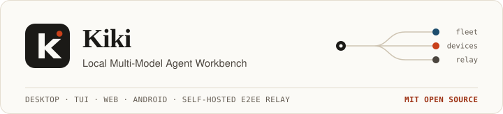
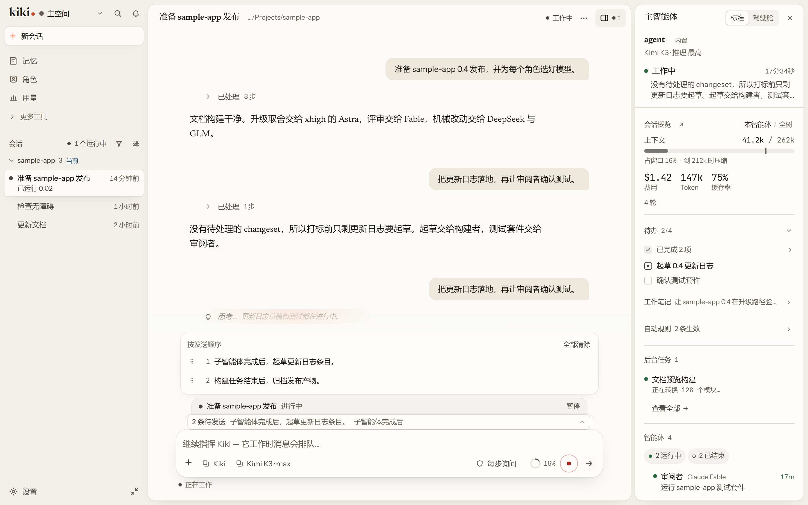
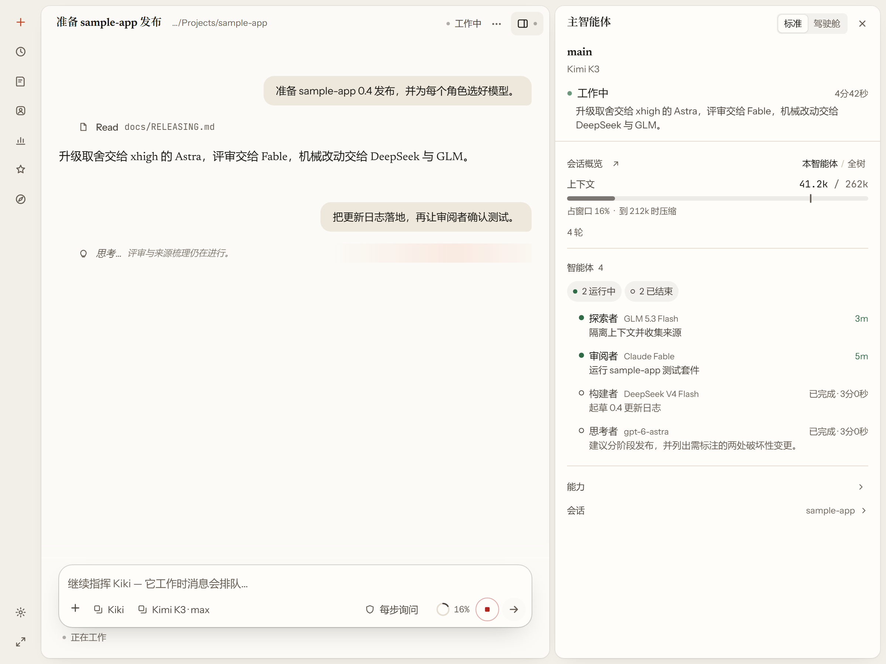
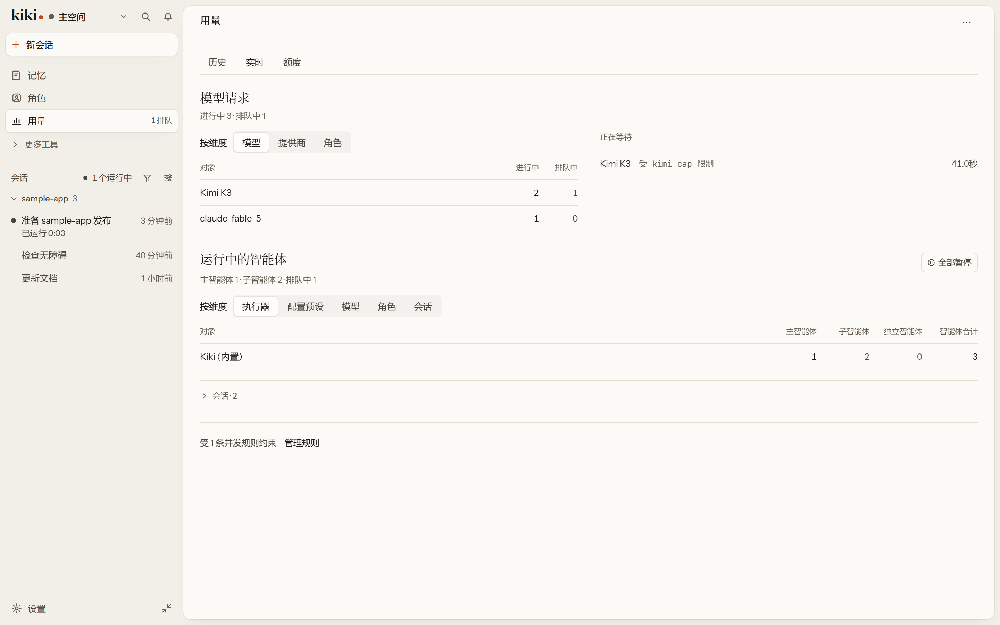
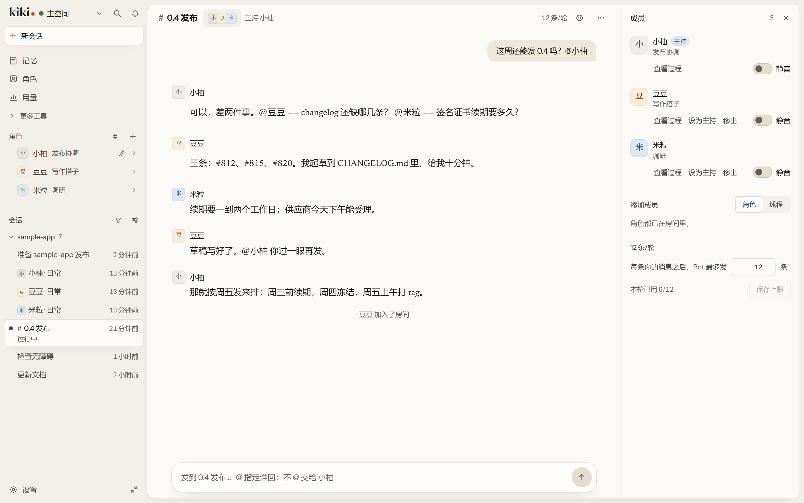

<div align="center">

<picture>
  <source media="(prefers-color-scheme: dark)" srcset="docs/public/assets/banner-dark.svg">
  
</picture>

[](https://github.com/X-T-E-R/kiki/releases) [](LICENSE) [](https://x-t-e-r.github.io/kiki/zh/)

[下载安装](#从这里开始) · [文档](https://x-t-e-r.github.io/kiki/zh/) · [插件市场](https://github.com/X-T-E-R/kiki-plugins) · [模型配方](https://github.com/X-T-E-R/kiki-recipes) · [截图巡览](marketing/gallery.zh-CN.md) · [问题反馈](https://github.com/X-T-E-R/kiki/issues)

[English](README.md) · 简体中文 · [Türkçe](README.tr.md)

</div>

**一件事，几家模型分工做；桌面、终端、浏览器和手机连成同一个工作台。**

Kiki 是开源的本地智能体工作台。主会话把活拆开：规划交给强模型，日常步骤交给便宜模型，审查换一家厂商。在同一个会话里，官方插件还能直接操作实体手机、本机桌面、远程虚拟机以及 PDF / Office / 3D 文件。每个帮手用哪个模型、能做到哪一步，都由你定——你的智能体，你说了算。

- **多厂商模型同场分工，每个模型配自己的专武。** Kimi、Anthropic、OpenAI 与 Codex、Gemini、Vertex AI 能在同一个会话里一起用，也支持 GitHub Copilot 和 ChatGPT 登录。每个原生模型都能绑定一套[配方（Recipe）](https://x-t-e-r.github.io/kiki/zh/customization/recipes)——提示词、模型设置与可选脚本 Hook 装一次就绑在模型上。作者发布了[五套公开配方](https://github.com/X-T-E-R/kiki-recipes)（GPT-6.1 Sol、GPT-6 Astra、DeepSeek V4.1、Gemini 4 Argon、Gemini 3.8 Flash），可以照着改，也可以自己写。
- **直接操控真机与远程桌面。** 官方插件把同一个智能体接到实体安卓 / iOS 手机（[`kiki-phone`](https://github.com/X-T-E-R/kiki-plugins/tree/main/plugins/official/kiki-phone)，支持常驻热连 `scrcpy`）、本机多屏高分桌面（[`kiki-cua`](https://github.com/X-T-E-R/kiki-plugins/tree/main/plugins/official/kiki-cua)）以及网易 UU 远程、Proxmox VE 虚拟机和 VNC 桌面（[`kiki-uu-remote`](https://github.com/X-T-E-R/kiki-plugins/tree/main/plugins/official/kiki-uu-remote)），60fps 预览面板在切换会话时常驻（`0ms` 重开），并内置一键人工接管防抢锁。
- **跨设备直连，数据留在你自己的机器上。** 工作文件留在原文件夹，会话、历史和配置存在本机 Kiki home，模型请求只发往你自己连接的供应商或本地服务。Electron 桌面端、终端（`kiki`）、浏览器（`kiki web`）、安卓客户端（可连电脑端，经局域网或自建端到端加密 `kiki-relay`；也可在手机上直接跑内置 Bionic Node 本地运行）以及微信 / QQ 绑定看到的是同一场工作。
- **文档、媒体与每一步都看得见。** 官方插件覆盖本地 PDF / Office 提取（`kiki-extract`）、Word / Excel / PowerPoint 编辑（`kiki-office`）、CSV 核对（`kiki-work`）与图像 / 视频 / 语音 / 3D 生成（`kiki-media`）。谁在做什么、花了多少、被哪条并发规则挡着、提示词怎么生效，都能点开核对。

<picture>
  <source media="(prefers-color-scheme: dark)" srcset="docs/public/shots/theme-dark/wl-20261005-hero-workbench.zh.dark.png">
  
</picture>

## 从这里开始

### 下载桌面版、安卓版或 CLI

从 [GitHub Releases](https://github.com/X-T-E-R/kiki/releases) 的 `kiki-v<版本号>` 直接下载对应平台：

| 平台 | 桌面 / 移动应用 | 独立 CLI / TUI |
| --- | --- | --- |
| Windows x64 | [`Kiki_*_x64-setup.exe`](https://github.com/X-T-E-R/kiki/releases/latest)（自动把 `kiki` 加入用户 `PATH`；0.7+ 内置自包含 Git Bash 与 `rg` 工具链） | 已包含在安装包里 |
| macOS Apple Silicon | [`Kiki_*_aarch64.dmg`](https://github.com/X-T-E-R/kiki/releases/latest) | `kiki-darwin-arm64` |
| macOS Intel | [`Kiki_*_x64.dmg`](https://github.com/X-T-E-R/kiki/releases/latest) | `kiki-darwin-x64` |
| Linux x64 | [`Kiki_*_amd64.deb`](https://github.com/X-T-E-R/kiki/releases/latest)（安装 `kiki` 命令）或 `.AppImage` | `kiki-linux-x64` |
| Linux ARM64 | — | `kiki-linux-arm64` |
| Android 7.0+ | [`Kiki_*_android-release.apk`](https://github.com/X-T-E-R/kiki/releases/latest)（支持连电脑或手机本地独立运行；内置签名校验自动更新） | — |

首次打开桌面版时，连接一个模型（账号登录、填入先验证再保存的 API 密钥，或检测本机已有登录），也可以先开一分钟离线导览（侧栏的 **发现 Kiki** 随时可再次打开）。

Linux 或 macOS 无需 Node.js，一行安装独立 CLI：

```sh
curl -fsSL https://github.com/X-T-E-R/kiki/releases/latest/download/install.sh | sh
```

也可以通过 npm 安装（需要 Node.js 24.22.1+ 或 26.12.1+）：

```sh
npm install -g kiki-agent   # CLI/TUI + 对应桌面构建（仅装终端用 `kiki-agent-lite`）
cd your-project
kiki                        # 终端界面；`kiki web` 打开浏览器界面，`kiki desktop` 打开桌面应用
```

<details>
<summary>校验文件、macOS 首次打开与 Windows CLI 说明</summary>

- 所有安装包、APK 与独立 CLI 均附带同名 `.sha256` 校验文件（安卓发布另附 `android-receipt.json`）。安装后运行 `kiki --version` 验证。
- **macOS：** `.dmg` 目前未签名、未公证。先校验下载，拖入「应用程序」，首次启动用 **按住 Control 键点按 → 打开**；dmg 不会修改 `PATH`，如需在终端调用 `kiki` 可手动软链内置可执行文件。
- **Windows：** 0.7+ 的 Electron 桌面安装包已自带可移植的 Git Bash、`git` 与 `rg`，开箱即用无需额外下载。若在 Windows 上仅通过 npm 安装 CLI（不含桌面包），需安装 [Git for Windows](https://gitforwindows.org/)，或将 `KIKI_SHELL_PATH` 设为 `bash.exe` 的绝对路径。
- 校验命令、更新通道与 `install.sh --apply` 云端笔记本一键同步空间，见[安装](https://x-t-e-r.github.io/kiki/zh/getting-started/installation)。

</details>

### 第一次任务

在终端运行 `/login`（或在桌面版打开 **设置 → AI**），选择 Kimi Code OAuth、Kimi 开放平台 API 密钥或[平台与模型](https://x-t-e-r.github.io/kiki/zh/configuration/providers)中的其他供应商，然后直接交任务：

```
帮我看一下这个项目的目录结构，简单介绍一下每个目录是做什么的
```

文件夹里不是代码也一样。从插件目录安装 [Kiki Extract](https://x-t-e-r.github.io/kiki/zh/customization/plugins#本地文档提取)（处理 PDF 与 Office 格式需本机备好 Python 与 MarkItDown）或 [Kiki Office Suite](https://github.com/X-T-E-R/kiki-plugins/tree/main/plugins/official/kiki-office)，再直接下达任务：

```
把 ./sources 里的 PDF 读一遍，拿里面的数字和 budget.xlsx 核对，把结果和每个数字来自哪个文件写进 summary.md
```

新会话默认是「自动」模式：日常操作直接执行，碰到敏感文件或危险命令仍会先问你。`/permission` 在「每步询问」（`manual`）、「自动」（`auto`）、「替我审批」（`review`）和「完全放行」（`yolo`）之间切换。

## 先做一件事

选好 Kiki 在哪个文件夹里工作、读哪些材料，再把任务交给它。普通、Plan 和 Goal 决定这件事怎么做，结果会带上来源和背后的步骤。新建会话时还可以选一个 git worktree，这个会话的改动就落在自己的分支上，不碰你当前的检出。临时对话不进历史、搜索和记忆，结束即删除。

见[首次启动](https://x-t-e-r.github.io/kiki/zh/getting-started/first-launch)和[交互与审批](https://x-t-e-r.github.io/kiki/zh/guides/interaction)。

## 看懂与指挥工作

### 每个智能体各用各的模型

主智能体拆任务、派子智能体，每个都能绑不同的模型或不同的厂商，在同一个会话里同时跑。强推理模型做规划，便宜的模型跑日常；换个厂商审查，也不会和实现共享同一批盲区。Kimi 开箱即用；Anthropic、OpenAI 兼容服务、OpenAI Responses API、Gemini 和 Vertex AI 都能接，也可以用 GitHub Copilot 或 ChatGPT 账号登录。



智能体本身是你自己的 Markdown 文件：frontmatter 写工具、模型、思考强度和能派发谁，正文就是系统提示词。保存文件后，下一次派发就会用上新内容；已经在跑的会话保留启动时的快照，直到你重建它的上下文。新建时可以从现有 profile 复制、从内置模板起，或者从空白开始。

点开任何一个被派出去的子智能体就能读它自己的记录，也能在它自己的输入框里给它发消息。智能体干活时，你打的字进队列而不是打断它，每条排队消息可以选本轮结束后、子智能体完成后，或任务完成后发出。耗时的命令转到后台，跑完自动通知智能体，它不用反复去查。见[一个工作台，好几条线](https://x-t-e-r.github.io/kiki/zh/features/workbench)和 [Agent 与 subagent](https://x-t-e-r.github.io/kiki/zh/customization/agents-and-subagents)。

### 在手头的窗口里干活

做完的一段工具调用、思考和 shell 输出折成一行，比如「Worked · 8 steps」，每折都能按原顺序展开。右栏显示待处理的审批和问题、智能体此刻在做什么、上下文和花费、它的工作笔记、智能体团队和后台任务——进到子智能体里，它也跟着过去。批注让你在消息上留一句话、随下一条一起发出去，不必单独打断一轮。

智能体可以用 `HistorySearch` 和 `HistoryRead` 搜自己之前的消息和工具输出——压缩前的内容也在范围内——侧栏里可以按标题搜会话。后台 CPU Worker 流式建立日志索引，即使跑了数周、体积超过 3GB 的长会话也能亚秒级冷打开、不卡主界面；缓存安全的上下文压缩会在压缩边界保留 KV-cache 前缀（250k+ 长会话仍可维持 `>=99%` 缓存命中），不至于一做摘要就把后续提示词成本打爆。联网搜索和抓取走可查看的具名通道，GitHub 仓库搜索不需要密钥。外观有六套内置皮肤、图片和视频背景，以及把配色和背景素材打包在一起的外观包。见[每天用的桌面](https://x-t-e-r.github.io/kiki/zh/features/daily)和[外观](https://x-t-e-r.github.io/kiki/zh/features/look)。

### 知道花了多少，也知道数字能送去哪儿

**用量（Usage）** 页把一个日期区间拆成 token、费用和缓存命中率——从未返回用量的平台显示为未知，而不是一个真实的 0——并写明是哪条并发规则挡着每一个等待中的请求。外部同步只发不含内容的统计，提示词、回答、标题和路径一律不发，目的地可以是你自己的 webhook、VibeCafe 账号或一条你批准的脚本；只有你添加目的地、预览确切内容、同意并启用后才会发送。



见[每天用的桌面](https://x-t-e-r.github.io/kiki/zh/features/daily)和 [`kiki usage-export`](https://x-t-e-r.github.io/kiki/zh/reference/command#kiki-usage-export)。

## 让工作持续

目标让主线跨多轮挂着，不必每次重述一遍任务。

比会话活得更久的是记忆：偏好、反馈、已核实的项目事实和参考资料，按全局、工作区或角色分别保存，每条写明内容依据和复核条件。每一条你都能看，常规改动都能逐条撤销——删除也能撤销；只有显式 `forget` 会永久清除历史。把新增记忆设为先放入收件箱审核，提议的写入会先等你批准，而不是自己生效。条目可以导出为 Markdown，改完核对差异再保存；也可以开启记忆顾问，让你选定的决策服务或模型为每轮挑选合适的条目。见[记忆指南](https://x-t-e-r.github.io/kiki/zh/guides/memory)。

安装可选的 `kiki-task-board` 插件后，每个工作区还会有一块看板，需求作为卡片关联到正在处理它的会话，智能体自己能读能改。定时提示词覆盖周期性工作：按 cron 触发，只要还有 Kiki 进程持有那个已打开的会话就会跑。见[长时间的活](https://x-t-e-r.github.io/kiki/zh/features/long-work)。

## 按需扩展 Kiki

### 能一起干活的角色

**角色**是长期身份——名字、头像、职责、它该怎样工作的长期约定，以及它自己的记忆——存成一份你能读能改的 Markdown。点它的名字，每次落进的都是同一个对话，所以「找小柚」是同一件事；同一个角色也可以同时有多段对话，分头做不同项目。

**房间**让两到六个角色围绕同一个话题按顺序发言，有主持人、有预算、有暂停和继续。除此之外，**跨会话对等线程通信**（`ThreadSend` / `ThreadRead` / `ThreadWait` 与 `@Thread` 引用）让长期常驻的工程、调研或巡检会话能直接交换结论、互相唤醒。

角色不等于智能体配置（profile）。profile 是执行配置——工具、权限、模型、思考强度；角色是身份——它是谁、记得什么。改一个绑定不会动另一个。见[能一起干活的人](https://x-t-e-r.github.io/kiki/zh/features/people)。



### 技能、插件与设备控制

插件可以加入技能、智能体、MCP 服务器、hooks、命令、工作台面板和工具，在「能力」页从[官方插件目录](https://github.com/X-T-E-R/kiki-plugins)浏览安装。每个包独立版本化、固定 SHA-256 校验，按需独立配置和启停：

- **真机与远程桌面控制：** `kiki-cua`（本机多屏高分桌面操控与跨插件远控总线）、`kiki-phone`（通过 Mobilewright 或 Mobile MCP 操作实体安卓 / iOS 手机，带常驻热连 `scrcpy`）以及 `kiki-uu-remote`（网易 UU 远程、Proxmox VE 虚拟机无损 RFB 3.8 直连与 VNC 远程桌面），60fps 预览面板跨会话切换常驻（`0ms` 重开），并提供一键人工接管防抢锁。
- **文档、媒体与日常运维：** `kiki-extract`（本地 PDF / Office / HTML 转 Markdown）、`kiki-office`（Word / Excel / PowerPoint 编辑与预览）、`kiki-work`（本地只读 CSV / TSV 核对）、`kiki-writing`、`kiki-notion`、`kiki-media`（图像、视频、语音与 3D 供应商及自定义本地脚本）、`kiki-voice`、`kiki-task-board`、`kiki-sites`、`kiki-mail`、`kiki-qq`、`kiki-bilibili`、`kiki-everything`（Windows Everything 1.5 索引检索）和 `kiki-output-layer`。
- **浏览器与网络桥接：** 浏览器控制按需连接 Ego Lite、浏览器扩展（Codex / ChatGPT 或 Kimi Browser Extension）、独立受管浏览器或 CDP；跨网连接可选 `kiki-relay`（自建端到端加密中转）或 `kiki-cloudflare`（Cloudflare Tunnel）。

会话留在你自己的机器上，不依赖第三方托管云中转；无公网 IP 又需要跨设备直连时，可按需自建 `kiki-relay`，内层流量全程端到端 TLS 1.3 并固定到本机空间的 SPKI 指纹。见[扩展](https://x-t-e-r.github.io/kiki/zh/features/extend)和[插件](https://x-t-e-r.github.io/kiki/zh/customization/plugins)。

## 数据与机器都在你手上

**空间**就是你要打开的某一个 Kiki，有自己的快捷方式、窗口行为和凭据范围——与主空间共享，或者本空间独立——所以工作的 Kiki 和个人的 Kiki 可以并排放着，不必共享能登录的东西。

**安卓客户端（双模式）：** 首次打开时选择「连接电脑 Kiki」（经局域网或自建端到端加密 `kiki-relay` 直连电脑端，手机不拉起本地后端）或「在本机运行 Kiki」（在安卓手机内嵌 Bionic Node 独立运行）。官方签名 APK 支持应用内 SHA-256 与签名证书校验更新。

**自建加密中转（`kiki-relay`）：** 电脑在 NAT 后且没有公网 IP 时，可以用 Node.js 或 Docker 自建轻量反向连接池中转服务。内层通信保持端到端 TLS 1.3 并固定目标空间的 P-256 SPKI 指纹（`fp`），中转节点既不终止内层 TLS，也看不到会话凭据或内容。

**远端连接**把一个 Kiki home 指向另一个，两边各自审批，每条连接是带自己状态的一行。**Thread bridge** 更窄：两个 home 之间传消息的单向通道，永远不给浏览权限。**Web 访问**用一条一次性链接把这个 Kiki 开给另一台设备上的浏览器，关掉时撤销所有链接，但不会停掉已经在跑的活。加入会话的 **SSH 主机**属于这个会话，所以时间线保持干净。把微信或 QQ 聊天绑到角色或会话上，人不在电脑前也能在手机上回消息、批权限。见[数据与机器都在你手上](https://x-t-e-r.github.io/kiki/zh/features/spaces)和[手机会话](https://x-t-e-r.github.io/kiki/zh/features/phone)。

## 带进历史，接上别的工具

内置提示词的任意字段都能换掉，细到单个工具描述，可以全局、按模型或按智能体设，`kiki prompt-fields` 能看到模型最终收到什么。把别的工具的对话导成能接着做的 Kiki 会话，或只读归档；预览会告诉你保留什么、不保留什么，不用安装也不用信任任何东西。`kiki acp` 让 Kiki 跑在 Zed、JetBrains 等 ACP 客户端里，`kiki seat` 让 Cursor、Claude Code、Codex 作为服务调用它，工作区、权限模式和模型在它们连上之前就定好了。一个 agent profile 也可以整个跑在别的 harness 上当引擎。见[带过来，也接得进外面](https://x-t-e-r.github.io/kiki/zh/features/ecosystem)和[每一层都归你](https://x-t-e-r.github.io/kiki/zh/features/freedom)。

## 文档

[全部功能](https://x-t-e-r.github.io/kiki/zh/features/) · [首次启动](https://x-t-e-r.github.io/kiki/zh/getting-started/first-launch) · [Kiki 桌面版](https://x-t-e-r.github.io/kiki/zh/getting-started/desktop-app) · [Agent Profiles](https://x-t-e-r.github.io/kiki/zh/customization/agent-profiles) · [插件](https://x-t-e-r.github.io/kiki/zh/customization/plugins) · [交互与审批](https://x-t-e-r.github.io/kiki/zh/guides/interaction) · [配置](https://x-t-e-r.github.io/kiki/zh/configuration/config-files) · [命令参考](https://x-t-e-r.github.io/kiki/zh/reference/command) · [工具参考](https://x-t-e-r.github.io/kiki/zh/reference/tools)

## 从源码开发

环境要求：Node.js 24.22.1+ 或 26.12.1+，pnpm 10.33.0。

```sh
git clone https://github.com/X-T-E-R/kiki.git && cd kiki && pnpm install
pnpm dev:cli    # 以开发模式运行 CLI
pnpm test       # 测试  ·  pnpm typecheck  ·  pnpm lint  ·  pnpm build
```

完整贡献指南见 [CONTRIBUTING.md](CONTRIBUTING.md)。问题请提到 [Issues](https://github.com/X-T-E-R/kiki/issues)；安全漏洞请参见 [SECURITY.md](SECURITY.md)。

## 致谢

Kiki 最初是 [Kimi Code](https://github.com/MoonshotAI/kimi-code) 的 fork，现已独立发展；TUI 构建于 [`pi-tui`](https://github.com/earendil-works/pi-mono/tree/main/packages/tui) 之上；桌面应用还改编了其他几个开源项目的代码和交互方式。每个项目 Kiki 用了什么、采用什么许可证，见 [ACKNOWLEDGEMENTS.zh-CN.md](ACKNOWLEDGEMENTS.zh-CN.md)。

## 许可证

基于 [MIT 许可证](LICENSE)发布。

## 友链

[Linux.do](https://linux.do/)
